<picture>
  <source media="(prefers-color-scheme: dark)" srcset="https://raw.githubusercontent.com/Rao-Abid-Saleem/Rao-Abid-Saleem/main/assets/banner-dark.svg" />
  <source media="(prefers-color-scheme: light)" srcset="https://raw.githubusercontent.com/Rao-Abid-Saleem/Rao-Abid-Saleem/main/assets/banner-light.svg" />
  
</picture>

 
 

 

---

## 👋 About me

I'm **Rao Abid Saleem**, a full-stack developer at **Preesoft** in Lahore. I build **multi-tenant SaaS products** across the whole stack, from the database schema to the dashboard.

Most of my work is in **TypeScript**: APIs in **Node.js, Express, and NestJS**, data in **MongoDB (Mongoose)** and **PostgreSQL (Prisma)**, and interfaces in **React** with Tailwind or MUI. I've shipped auth and tenancy, Stripe billing, invoicing engines, PDF document generation, and **Socket.IO** chat into products that real teams use every day.

I care about tenant isolation that holds up, endpoints that validate their input and fail clearly, and features that work in production and keep working after the next release.

<table>
  <tr>
    <td width="50%" valign="top">
      <b>🧱 Multi-tenant SaaS</b> 
      Org-scoped data, role-based access, invites, subscription plans, and super-admin consoles.
    </td>
    <td width="50%" valign="top">
      <b>💳 Billing &amp; invoicing</b> 
      Stripe checkout, billing portal and webhooks, rate cards, and per-line invoice PDFs.
    </td>
  </tr>
  <tr>
    <td width="50%" valign="top">
      <b>📄 Documents &amp; reports</b> 
      Dynamic agreements, consent forms, inspection reports, and e-signed PDFs stored in S3.
    </td>
    <td width="50%" valign="top">
      <b>⚡ Realtime &amp; dashboards</b> 
      Socket.IO chat, live location, and analytics endpoints that feed manager dashboards.
    </td>
  </tr>
</table>

## 🧰 Tech stack

| | |
| :-- | :-- |
| **Languages** |   |
| **Backend** |        |
| **Frontend** |       |
| **Data** |      |
| **Realtime** |   |
| **Payments &amp; docs** |     |
| **Cloud / DevOps** |      |
| **Testing** |    |

## ⚙️ Multi-tenant SaaS architecture

One API serves several clients: admin consoles, company portals, and mobile apps. Every request is scoped to its tenant before any business logic runs.

<picture>
  <source media="(prefers-color-scheme: dark)" srcset="https://raw.githubusercontent.com/Rao-Abid-Saleem/Rao-Abid-Saleem/main/assets/saas-architecture-dark.svg" />
  <source media="(prefers-color-scheme: light)" srcset="https://raw.githubusercontent.com/Rao-Abid-Saleem/Rao-Abid-Saleem/main/assets/saas-architecture-light.svg" />
  
</picture>

- **Tenant isolation**: tenancy comes from the token, never from the client, and admin views, decisions, and notifications are all request-scoped.
- **Auth that holds up**: JWT with RBAC, per-organization roles, invites that can't take over an existing account, server-issued device trust, and machine-readable error codes.
- **Global catalogs, tenant copies**: super-admins publish product and payment catalogs, and each company imports and edits its own copy.
- **Hardened by default**: per-route body limits, constant-time secret checks, secrets sent in headers instead of URLs, and no unauthenticated routes left over.
- **Fast where it matters**: the right indexes, batched queries, and list endpoints rewritten when they got slow.

## 🔁 Full-stack feature delivery

I take a feature from the schema to the screen, so the API contract and the UI that uses it are built together.

<picture>
  <source media="(prefers-color-scheme: dark)" srcset="https://raw.githubusercontent.com/Rao-Abid-Saleem/Rao-Abid-Saleem/main/assets/feature-delivery-dark.svg" />
  <source media="(prefers-color-scheme: light)" srcset="https://raw.githubusercontent.com/Rao-Abid-Saleem/Rao-Abid-Saleem/main/assets/feature-delivery-light.svg" />
  
</picture>

- **Model**: Mongoose or Prisma schemas with migrations and indexes planned from the start.
- **API**: Express (with Inversify) or NestJS modules, guards, DTO validation, and clear error responses.
- **UI**: React with Tailwind or MUI, data through TanStack Query or SWR, and loading, empty, and error states handled.
- **Live**: Socket.IO for chat, unread counts, and live updates, with cache updates that don't race.
- **Ship**: Docker images through GitHub Actions to AWS ECS, plus Supabase edge functions and Cloudflare where a project uses them.

## 🚀 Featured work

Most of my work is client work in private repositories, so the products below are described without names or links.

| Product | What I built | Stack |
| :-- | :-- | :-- |
| **Field-sales &amp; install CRM** | Multi-tenant API behind an admin console, a company portal, and a mobile app. Dynamic agreements and e-signed PDFs, inspection and weather-risk reports, global catalog imports, payment plans, sales analytics, job-builder drafts with email and SMS review, live rep location, and a security-hardening pass. | Node.js · Express · TypeScript · Inversify · MongoDB · Socket.IO · AWS |
| **HR &amp; invoicing SaaS** | Per-organization roles and tenant isolation, a super-admin console for tenants and plans, rate cards, an invoicing engine with per-day ledgers, client invoices with margins and PDF export, CRM bulk import, and project-based group chat. | NestJS · Prisma · PostgreSQL · React 19 · Tailwind · TanStack Query · Socket.IO |
| **Business promotions portal** | Self-serve portal where local businesses create promotions: Stripe checkout, billing portal and webhooks, plan limits, an image cropper, AI-generated promo designs with moderation, and review flows. | React · TypeScript · Vite · Supabase Edge Functions · Stripe · Cloudflare |
| **Auth service** | JWT auth service with layered handlers and services, request validation, and image uploads. | Express · TypeScript · Inversify · Mongoose · Cloudinary |

<a href="https://github.com/Rao-Abid-Saleem?tab=repositories"><b>Explore my repositories →</b></a>

## 📊 GitHub at a glance

<picture>
  <source media="(prefers-color-scheme: dark)" srcset="https://streak-stats.demolab.com?user=Rao-Abid-Saleem&theme=tokyonight&hide_border=true&ring=10B981&fire=10B981&currStreakLabel=34D399" />
  <source media="(prefers-color-scheme: light)" srcset="https://streak-stats.demolab.com?user=Rao-Abid-Saleem&theme=default&hide_border=true&ring=059669&fire=059669&currStreakLabel=059669" />
  
</picture>
<picture>
  <source media="(prefers-color-scheme: dark)" srcset="https://github-readme-stats.vercel.app/api/top-langs/?username=Rao-Abid-Saleem&layout=compact&langs_count=6&hide=css%2Chtml&size_weight=0.25&count_weight=0.75&theme=tokyonight&hide_border=true" />
  <source media="(prefers-color-scheme: light)" srcset="https://github-readme-stats.vercel.app/api/top-langs/?username=Rao-Abid-Saleem&layout=compact&langs_count=6&hide=css%2Chtml&size_weight=0.25&count_weight=0.75&theme=default&hide_border=true" />
  
</picture>

<picture>
  <source media="(prefers-color-scheme: dark)" srcset="https://github-readme-activity-graph.vercel.app/graph?username=Rao-Abid-Saleem&theme=tokyo-night&area=true&height=280&days=30&hide_border=true&line=10B981&point=38BDF8&area_color=10B981&color=94A3B8&title_color=6EE7B7&custom_title=Contribution%20activity" />
  <source media="(prefers-color-scheme: light)" srcset="https://github-readme-activity-graph.vercel.app/graph?username=Rao-Abid-Saleem&theme=github&area=true&height=280&days=30&hide_border=true&bg_color=FFFFFF&line=059669&point=0284C7&area_color=10B981&color=475569&title_color=047857&custom_title=Contribution%20activity" />
  
</picture>

## 🐍 Contribution graph

<picture>
  <source media="(prefers-color-scheme: dark)" srcset="https://raw.githubusercontent.com/Rao-Abid-Saleem/Rao-Abid-Saleem/output/github-contribution-grid-snake-dark.svg" />
  <source media="(prefers-color-scheme: light)" srcset="https://raw.githubusercontent.com/Rao-Abid-Saleem/Rao-Abid-Saleem/output/github-contribution-grid-snake.svg" />
  
</picture>

## 🔭 Currently

- Building **multi-tenant SaaS** at Preesoft across NestJS, Express, and React.
- Going deeper on **PostgreSQL and Prisma**, realtime systems, and secure API design.
- Finishing my **BS in Computer Science** at Virtual University of Pakistan.
- Open to collaborating on well-scoped full-stack and SaaS products.

## 🤝 Let's connect

Have a SaaS product to build, an API to harden, or a dashboard that needs live data? I'd love to hear about it.

 

<picture>
  <source media="(prefers-color-scheme: dark)" srcset="https://raw.githubusercontent.com/Rao-Abid-Saleem/Rao-Abid-Saleem/main/assets/footer-dark.svg" />
  <source media="(prefers-color-scheme: light)" srcset="https://raw.githubusercontent.com/Rao-Abid-Saleem/Rao-Abid-Saleem/main/assets/footer-light.svg" />
  
</picture>
